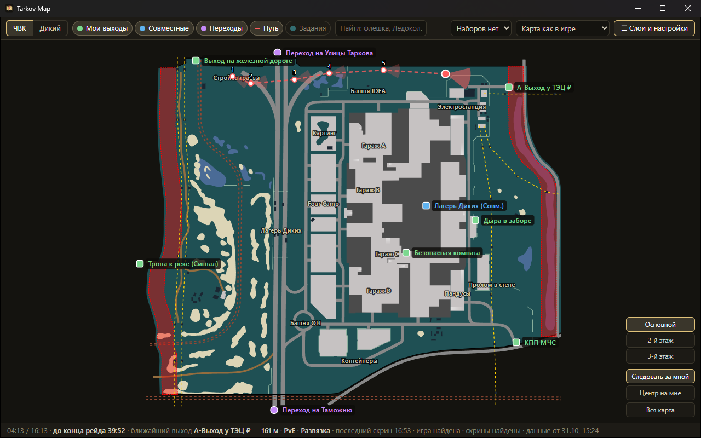
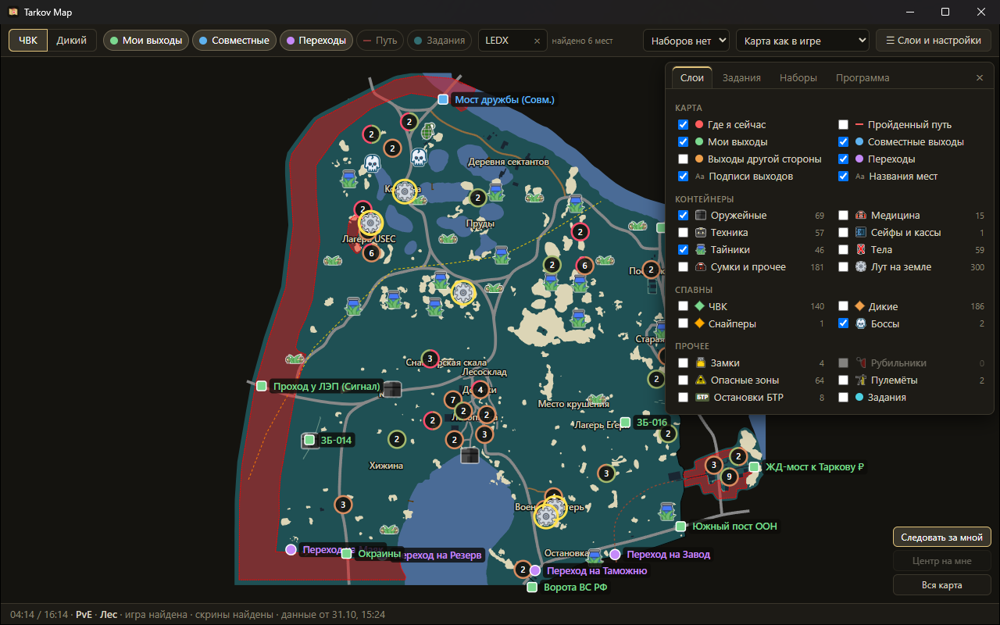

<div align="center">


# Tarkov Map

**Карта Escape from Tarkov для второго монитора: где вы, куда смотрите, выходы и лут.**


</div>



## Что умеет

- **Где я и куда смотрю.** Нажали в рейде клавишу скриншота — на карте появляются точка и конус взгляда. Из нескольких скриншотов складывается пройденный путь.
- **Сама выбирает карту.** По логам игры видно, какая карта загружается и в каком режиме — PvE и PvP показываются раздельно.
- **Выходы своей стороны.** ЧВК или Дикий, совместные выходы, платные отмечены ₽; переходы на другие карты. В строке статуса — ближайший выход и сколько до него метров.
- **Этажи.** На многоэтажных картах этаж выбирается по высоте последнего скриншота, метки других этажей приглушены.
- **Лут и места.** Названия мест, семь групп контейнеров, лут на земле с поиском по русскому названию, замки, рубильники, опасные зоны, пулемёты, боссы. Близкие метки собираются в группу с числом и распадаются при приближении.
- **Задания.** Цели заданий на карте и их список; «Только активные» — взятые и не сданные задания по логам игры.
- **Главное — на панели, остальное — в окне «Слои и настройки».** Любое сочетание слоёв можно сохранить набором под своим названием.
- **Любая карта вручную** — посмотреть до рейда, куда идти.
- **Без интернета.** Карты и данные встроены в exe: программу можно передать одним файлом.



## Как это работает

| Источник | Что из него берётся |
|---|---|
| Скриншоты игры | В имени файла Тарков записывает координаты и поворот камеры — отсюда точка и направление взгляда. Сам файл не открывается и не удаляется. |
| Логи игры (`Logs`) | Какая карта загружается, режим PvE/PvP, начало рейда. |
| Снимок [tarkov.dev](https://tarkov.dev) | SVG-карты, выходы, метки лута и русские названия. Встраивается в exe при сборке. |

> Программа не трогает процесс и память игры, ничего не рисует поверх неё и не ходит в сеть: она читает только файлы, которые игра сама пишет на диск.

## Установка

1. Возьмите `TarkovMap.exe` (Windows 10/11, 64 бита) со страницы [Releases](../../releases) или соберите по инструкции ниже и положите куда угодно.
2. При первом запуске Windows предупредит о неизвестной программе: «Подробнее» → «Выполнить в любом случае». Exe не подписан.
3. Папки игры и скриншотов программа найдёт сама. Если не нашла — укажите их в окне «Слои и настройки» → «Программа».

Нужен компонент WebView2: в Windows 11 он встроен, в Windows 10 почти всегда уже установлен.
Настройки и положение окна хранятся в `%LOCALAPPDATA%\TarkovMap\settings.json`.

## Сборка

Нужен Go 1.27+. Exe собирается кросс-компиляцией из Linux или WSL, CGO не нужен:

```bash
scripts/build.sh    # → build/bin/TarkovMap.exe
```

### Свежие данные после патча

```bash
go run ./scripts/seed    # данные tarkov.dev → assets/data.zip
scripts/build.sh
```

Если что-то скачалось битым или пустым, снимок не соберётся, а прежний `assets/data.zip` останется на месте.

### Тесты

```bash
go test -race ./...
scripts/wintest.sh internal/shots    # тесты, которым нужна настоящая Windows (запуск из WSL)
```

`scripts/smoke.ps1` проверяет окно на поддельных логах и скриншотах. `go run ./scripts/icon` перерисовывает иконку (`assets/appicon.png` и `rsrc_windows_amd64.syso`).

### Релизы

На каждый push в `main` и в pull request GitHub Actions гоняет тесты на Linux и Windows и собирает exe — он лежит в артефактах запуска три дня. Релиз с exe и контрольной суммой выпускается из `main` кнопкой **Actions → Сборка → Run workflow** с версией или командой:

```bash
gh workflow run build.yml -f version=v0.2.0
```

Тот же прогон проверяет код, ставит тег и выкладывает релиз — отдельно тег пушить не нужно. Версия попадает в «О программе», в текст релиза — дата данных и список изменений с прошлого тега.

## Устройство

```
main.go, app.go      окно Wails и методы для интерфейса
internal/core        рейд: карта, маршрут по скриншотам, что показать
internal/data        чтение встроенного снимка tarkov.dev
internal/gamelog     разбор логов игры
internal/shots       имена скриншотов и слежение за папкой
internal/mapgeo      координаты игры → координаты SVG, этажи
internal/paths       поиск папок игры и скриншотов
internal/settings    настройки
internal/winpos      положение окна
frontend/dist        интерфейс: HTML, CSS и JS без сборщика
scripts/             сборка, снимок данных, иконка, тесты
```

## Благодарности и лицензии

- Данные и SVG-карты — [tarkov.dev](https://tarkov.dev) ([the-hideout](https://github.com/the-hideout)). Карты распространяются по [CC BY-NC-SA 4.0](https://creativecommons.org/licenses/by-nc-sa/4.0/): только некоммерческое использование с указанием авторства.
- Значки меток — [the-hideout/tarkov-dev](https://github.com/the-hideout/tarkov-dev), MIT ([текст лицензии](frontend/dist/icons/LICENSE-tarkov-dev.txt)).
- Escape from Tarkov — торговая марка Battlestate Games. Проект с ней не связан.
